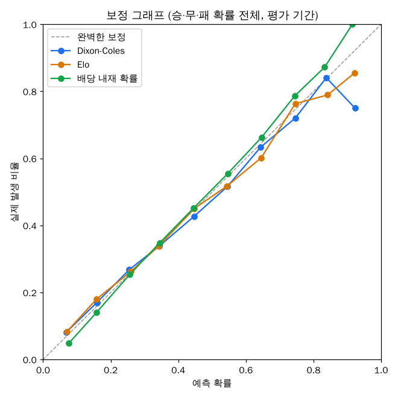

# 예측 모델 성능 비교 (자동 생성)

_생성: 2026-11-25 12:13 UTC — `python -m backend.models.evaluate`_

## 평가 방법

- **시간 순서 검증(walk-forward)**: 랜덤 분할 없이, 각 경기는 그 경기 이전 데이터로만 학습한 모델로 예측했다.
  - Dixon-Coles: 평가 기간을 주 단위로 나눠 매주 그 주 시작 전까지 끝난 경기(최근 2년, 시간 감쇠)로 다시 학습
  - Elo: 경기 전 레이팅 사용. 레이팅→승무패 확률 변환 계수는 평가 시즌 시작 전 경기로만 맞춤
- **정답**: 90분 결과 (연장·승부차기 경기는 무승부)
- **지표**: Log loss·Brier score는 **낮을수록 좋다**. 정확도는 참고용 (가장 높은 확률을 준 결과가 맞은 비율)
- **기준선**: 홈팀 항상 승(확률 1/0/0), 리그 평균(평가 시즌 전 승무패 비율), 배당 내재 확률(경기 전 평균 배당, 마진 제거)
- 평가 기간: AFC 챔피언스리그 엘리트 2025-26·2026-27, 벨기에 프로리그 2024-25·2025-26·2026-27, 잉글랜드 챔피언십 2024-25·2025-26·2026-27, 잉글랜드 프리미어리그 2024-25·2025-26·2026-27, 스페인 라리가 2024-25·2025-26·2026-27, 독일 분데스리가 2024-25·2025-26·2026-27, 이탈리아 세리에 A 2024-25·2025-26·2026-27, J1리그 2024·2025·2026-27, K리그1 2024·2025·2026, 네덜란드 에레디비시 2024-25·2025-26·2026-27, 포르투갈 프리메이라리가 2024-25·2025-26·2026-27, 스코틀랜드 프리미어십 2024-25·2025-26·2026-27, 튀르키예 쉬페르리그 2024-25·2025-26·2026-27

## 전체 (리그 경기, Dixon-Coles·Elo 공통 경기)

홈팀 항상 승은 무승부·원정승에 확률 0을 주므로 Log loss가 무한대(∞)다.

| 모델 | 경기 수 | Log loss | Brier | 정확도 |
|---|---|---|---|---|
| Dixon-Coles | 9682 | 1.0112 | 0.6048 | 0.4975 |
| Elo | 9682 | 1.0123 | 0.6057 | 0.4945 |
| 리그 평균 | 9682 | 1.0773 | 0.6521 | 0.4299 |
| 홈팀 항상 승 | 9682 | ∞ | 1.1403 | 0.4299 |

## 대회별 Log loss (낮을수록 좋음)

| 대회 | 경기 수 | Dixon-Coles LL | Elo LL | 리그 평균 LL | 가장 좋은 모델 |
|---|---|---|---|---|---|
| 벨기에 프로리그 | 731 | 1.0112 | 1.0142 | 1.0764 | Dixon-Coles |
| 잉글랜드 챔피언십 | 1296 | 1.0595 | 1.0554 | 1.0773 | Elo |
| 잉글랜드 프리미어리그 | 870 | 1.0094 | 1.0284 | 1.0844 | Dixon-Coles |
| 스페인 라리가 | 889 | 0.9744 | 0.9803 | 1.0617 | Dixon-Coles |
| 독일 분데스리가 | 702 | 1.0091 | 1.0043 | 1.0785 | Elo |
| 이탈리아 세리에 A | 880 | 0.9778 | 0.9817 | 1.0849 | Dixon-Coles |
| J1리그 | 910 | 1.0673 | 1.0588 | 1.0828 | Elo |
| K리그1 | 672 | 1.0926 | 1.0923 | 1.0912 | 리그 평균 |
| 네덜란드 에레디비시 | 729 | 0.9988 | 0.9946 | 1.0762 | Elo |
| 포르투갈 프리메이라리가 | 710 | 0.9381 | 0.9465 | 1.0834 | Dixon-Coles |
| 스코틀랜드 프리미어십 | 537 | 0.9842 | 0.9828 | 1.0640 | Elo |
| 튀르키예 쉬페르리그 | 756 | 0.9747 | 0.9709 | 1.0641 | Elo |

## 배당 내재 확률과 비교

배당은 시장 정보(부상·라인업 등)가 반영된 강한 기준선이다. 통계 모델이 이보다 나쁜 것은 정상이며, 차이가 얼마나 되는지를 본다.
(배당은 평가용으로만 쓰며 사이트에는 표시하지 않는다.)

| 모델 | 경기 수 | Log loss | Brier | 정확도 |
|---|---|---|---|---|
| 배당 내재 확률 | 8100 | 0.9747 | 0.5803 | 0.5294 |
| Dixon-Coles | 8100 | 0.9982 | 0.5958 | 0.5102 |
| Elo | 8100 | 1.0004 | 0.5973 | 0.5089 |

## AFC 챔피언스리그 (컵 대회, Elo만 적용)

서로 다른 리그 팀끼리 만나므로 리그별 Dixon-Coles를 쓸 수 없어 리그 통합 Elo로만 예측한다. 경기 수가 적어 참고용.

| 모델 | 경기 수 | Log loss | Brier | 정확도 |
|---|---|---|---|---|
| Elo | 176 | 1.0081 | 0.6029 | 0.5000 |
| 대회 평균 | 176 | 1.0546 | 0.6357 | 0.4773 |

## 보정(calibration)

예측 확률 구간별로 실제 발생 비율을 비교한다. 대각선에 가까울수록 확률을 믿을 수 있다.

### Dixon-Coles

| 구간 | 예측 평균 | 실제 비율 | 건수 |
|---|---|---|---|
| 0.0~0.1 | 0.0682 | 0.0811 | 888 |
| 0.1~0.2 | 0.1590 | 0.1698 | 3527 |
| 0.2~0.3 | 0.2545 | 0.2679 | 11132 |
| 0.3~0.4 | 0.3437 | 0.3384 | 5565 |
| 0.4~0.5 | 0.4464 | 0.4269 | 3565 |
| 0.5~0.6 | 0.5458 | 0.5170 | 2211 |
| 0.6~0.7 | 0.6434 | 0.6330 | 1229 |
| 0.7~0.8 | 0.7461 | 0.7203 | 615 |
| 0.8~0.9 | 0.8377 | 0.8407 | 270 |
| 0.9~1.0 | 0.9226 | 0.7500 | 44 |

### Elo

| 구간 | 예측 평균 | 실제 비율 | 건수 |
|---|---|---|---|
| 0.0~0.1 | 0.0697 | 0.0823 | 1008 |
| 0.1~0.2 | 0.1575 | 0.1794 | 3233 |
| 0.2~0.3 | 0.2602 | 0.2632 | 11191 |
| 0.3~0.4 | 0.3418 | 0.3381 | 6030 |
| 0.4~0.5 | 0.4468 | 0.4504 | 3528 |
| 0.5~0.6 | 0.5441 | 0.5175 | 2031 |
| 0.6~0.7 | 0.6450 | 0.6016 | 1019 |
| 0.7~0.8 | 0.7459 | 0.7630 | 633 |
| 0.8~0.9 | 0.8416 | 0.7893 | 318 |
| 0.9~1.0 | 0.9211 | 0.8545 | 55 |

## 오버/언더 2.5·양팀득점 (Dixon-Coles)

| 항목 | 경기 수 | 모델 Log loss | 기준선(50%) Log loss | 예측 평균 | 실제 비율 |
|---|---|---|---|---|---|
| 2.5골 초과 | 9682 | 0.6917 | 0.6931 | 0.5006 | 0.5282 |
| 양팀 득점 | 9682 | 0.6930 | 0.6931 | 0.5053 | 0.5405 |

## 데이터 한계

- 아시아 대회(K리그1·J1·ACL)는 경기 통계·xG가 없어 골 기반 모델만 쓴다.
- UEFA 대회·국내 컵 경기는 수집하지 않아 Elo가 그 경기들의 정보를 반영하지 못한다.
- xG는 2026/27 시즌부터만 있어 xG 기반 모델(8단계)은 데이터가 더 쌓인 뒤 평가한다.

## 8단계: 고급 모델 비교

### LightGBM (전체 리그, 같은 경기로 비교)

피처: 폼·득실·휴식일·H2H·xG/슈팅(있을 때)·Elo·Dixon-Coles 확률·대회. 매달 1일 그 전까지 끝난 경기로 다시 학습.

| 모델 | 경기 수 | Log loss | Brier | 정확도 |
|---|---|---|---|---|
| LightGBM | 7557 | 1.0079 | 0.6027 | 0.5023 |
| Dixon-Coles | 7557 | 1.0099 | 0.6038 | 0.5013 |
| Elo | 7557 | 1.0107 | 0.6043 | 0.4981 |

### xG Dixon-Coles (xG 있는 리그, 같은 경기로 비교)

⚠️ **데이터 부족 — 참고용**: xG는 2026/27 시즌부터만 있어 514경기만 평가했고, 학습 데이터도 시즌 초반 몇 달뿐이다. 시즌이 진행되며 매주 재검증한다.

| 모델 | 경기 수 | Log loss | Brier | 정확도 |
|---|---|---|---|---|
| xG Dixon-Coles | 514 | 0.9618 | 0.5693 | 0.5428 |
| Dixon-Coles | 514 | 0.9679 | 0.5743 | 0.5584 |

### 사이트에 반영하는 대표 모델

기본 모델보다 같은 경기에서 Log loss가 0.003 이상 낮고 비교 경기가 200개 이상인 모델만 대표로 바꾼다.

| 대회 | 대표 모델 | 기본 | 개선 | 이유 |
|---|---|---|---|---|
| AFC 챔피언스리그 엘리트 | Elo | Elo | - | 다른 모델이 기준(경기 200개 이상, Log loss 0.003 이상 개선)을 넘지 못함 |
| J1리그 | Elo | Dixon-Coles | 0.0073 | 530경기 비교에서 Log loss 0.0073 개선 |
| K리그1 | Elo | Dixon-Coles | 0.0076 | 444경기 비교에서 Log loss 0.0076 개선 |
| 네덜란드 에레디비시 | LightGBM | Dixon-Coles | 0.0064 | 585경기 비교에서 Log loss 0.0064 개선 |
| 독일 분데스리가 | LightGBM | Dixon-Coles | 0.0187 | 576경기 비교에서 Log loss 0.0187 개선 |
| 벨기에 프로리그 | Dixon-Coles | Dixon-Coles | - | 다른 모델이 기준(경기 200개 이상, Log loss 0.003 이상 개선)을 넘지 못함 |
| 스코틀랜드 프리미어십 | LightGBM | Dixon-Coles | 0.0116 | 439경기 비교에서 Log loss 0.0116 개선 |
| 스페인 라리가 | LightGBM | Dixon-Coles | 0.0061 | 718경기 비교에서 Log loss 0.0061 개선 |
| 이탈리아 세리에 A | Dixon-Coles | Dixon-Coles | - | 다른 모델이 기준(경기 200개 이상, Log loss 0.003 이상 개선)을 넘지 못함 |
| 잉글랜드 챔피언십 | Elo | Dixon-Coles | 0.0104 | 1048경기 비교에서 Log loss 0.0104 개선 |
| 잉글랜드 프리미어리그 | Dixon-Coles | Dixon-Coles | - | 다른 모델이 기준(경기 200개 이상, Log loss 0.003 이상 개선)을 넘지 못함 |
| 튀르키예 쉬페르리그 | LightGBM | Dixon-Coles | 0.0053 | 612경기 비교에서 Log loss 0.0053 개선 |
| 포르투갈 프리메이라리가 | Dixon-Coles | Dixon-Coles | - | 다른 모델이 기준(경기 200개 이상, Log loss 0.003 이상 개선)을 넘지 못함 |

⚠️ 모델 선택과 이 성능표에 같은 검증 기간을 썼으므로, 선택된 모델의 개선 폭은 실제보다 조금 좋게 보일 수 있다 (여러 후보 중 가장 좋은 것을 고른 효과). 매주 새로 쌓이는 경기로 다시 검증·선택한다.
